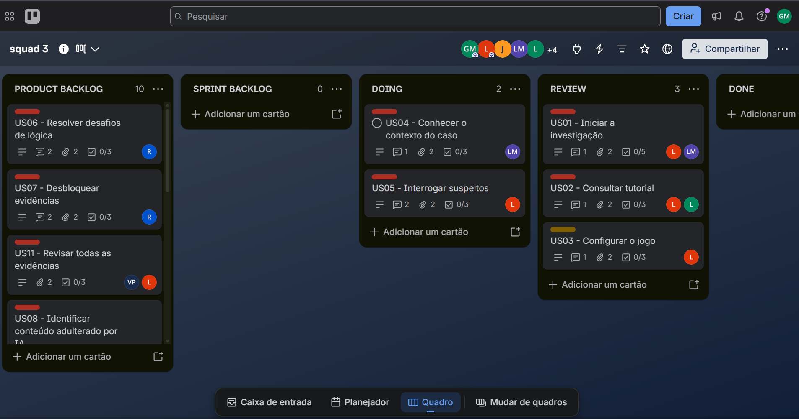
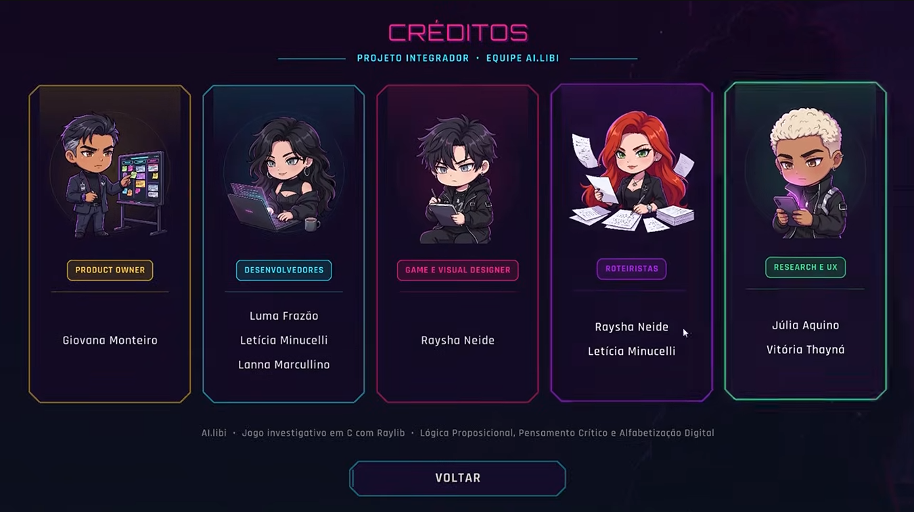
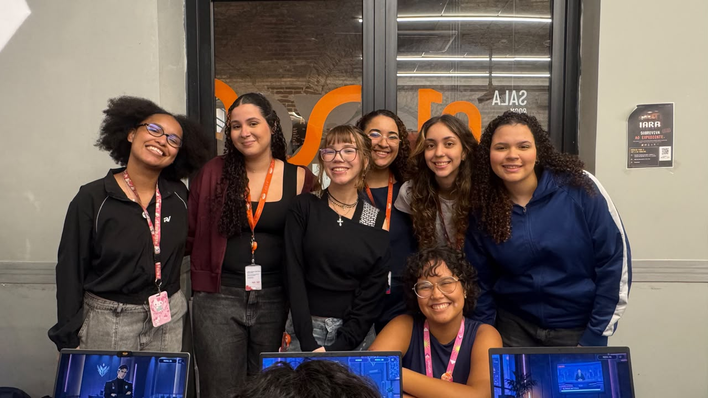
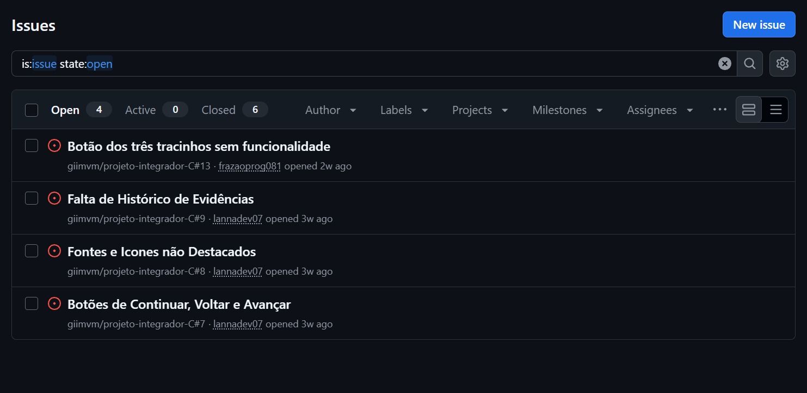
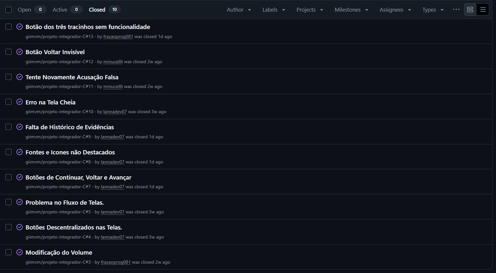

«AI.libi é um jogo investigativo que combina lógica proposicional, pensamento crítico e alfabetização digital para ensinar o jogador a questionar e analisar informações em um cenário onde conteúdos gerados por Inteligência Artificial podem ser usados para manipular uma investigação.»

---

## 📌 Sobre o Projeto

AI.libi é um jogo digital educativo no qual o jogador assume o papel de um investigador responsável por solucionar um caso criminal.

Ao longo da investigação, o jogador coleta depoimentos, analisa evidências e enfrenta desafios de lógica proposicional para avançar na narrativa. Além de resolver o caso, o jogador precisa avaliar criticamente as provas encontradas, identificando possíveis conteúdos manipulados ou gerados por Inteligência Artificial.

O projeto foi desenvolvido com o objetivo de unir aprendizado e entretenimento, incentivando o raciocínio lógico, a análise crítica de informações e a conscientização sobre os impactos das tecnologias de IA na produção de conteúdos digitais.

---

## 🎯 Objetivos

O AI.libi foi desenvolvido com os seguintes objetivos:

- Ensinar conceitos de lógica proposicional de forma prática e interativa;
- Desenvolver habilidades de raciocínio lógico e pensamento crítico;
- Estimular a análise e interpretação de evidências durante uma investigação;
- Promover a alfabetização digital em um contexto cada vez mais influenciado pela Inteligência Artificial;
- Demonstrar como conteúdos digitais podem ser manipulados ou gerados por IA;
- Incentivar a tomada de decisões baseadas em evidências e não apenas em suposições.

## 💡 Conceito principal

> **Nem toda evidência é verdadeira. Nem toda informação deve ser aceita sem questionamento.**

O AI.libi foi desenvolvido para demonstrar que uma informação aparentemente convincente nem sempre é verdadeira. Por meio da investigação, da lógica e da análise crítica, o jogador aprende a questionar evidências, verificar fatos e construir conclusões baseadas em informações confiáveis.

---

## 🎮 Como o jogo funciona

O jogador assume o papel de um detetive responsável por investigar um crime.

A investigação acontece por etapas, nas quais o jogador conversa com suspeitos, responde desafios de lógica e desbloqueia novas evidências relacionadas ao caso.

Durante a análise das evidências, o jogador deve identificar possíveis adulterações realizadas por Inteligência Artificial, cruzar informações e revisar os dados coletados para descobrir a verdade.

Ao final da investigação, o jogador deverá escolher quem considera culpado e receberá um relatório explicando os resultados alcançados.

           🕵️ INVESTIGAÇÃO
                  │
                  ▼
        ┌───────────────────┐
        │ Resolver desafio  │
        │ de lógica         │
        └─────────┬─────────┘
                  │
                  ▼
        🔓 Nova evidência
                  │
                  ▼
        🔎 Analisar evidência
                  │
          ┌───────┴───────┐
          ▼               ▼
       Confiável       Suspeita
          │               │
          └───────┬───────┘
                  ▼
          🧩 Cruzar evidências
                  │
                  ▼
           ⚖️ Conclusão do caso

---

# 🧠 Mecânicas Principais

| Mecânica | Descrição |
|-----------|-----------|
| 🔎 Investigação | Exploração da narrativa por meio da coleta de informações e análise de suspeitos |
| 💬 Interrogatórios | Conversas com personagens para obtenção de pistas e depoimentos |
| 🧩 Desafios de Lógica | Questões baseadas em lógica proposicional utilizadas para progressão da investigação |
| 🔓 Desbloqueio de Evidências | Novas provas são liberadas conforme o jogador avança no caso |
| 🤖 Análise de IA | Identificação de conteúdos possivelmente manipulados ou gerados por Inteligência Artificial |
| 📂 Dossiê de Evidências | Consulta e revisão das provas coletadas durante a investigação |
| ⚖️ Tomada de Decisão | Escolha do culpado com base nas evidências reunidas |
| 📊 Relatório Final | Explicação da solução do caso e análise das decisões tomadas pelo jogador |

---

## 🤖 Inteligência Artificial

A Inteligência Artificial possui um papel central na narrativa do jogo.

O jogador vive em um cenário onde tecnologias de IA podem ser utilizadas para criar ou manipular conteúdos digitais. Dessa forma, o jogo aborda a necessidade de verificar informações e analisar criticamente conteúdos que aparentam ser verdadeiros.

A proposta não é apenas ensinar o jogador a identificar uma imagem ou informação falsa, mas desenvolver o hábito de perguntar:

«"Como eu sei que isso é verdade?"»

---

## 📚 Conteúdos Educacionais

O jogo utiliza principalmente conceitos relacionados à lógica proposicional.

Entre os conteúdos trabalhados estão:

- Proposições simples e compostas;
- Valor lógico;
- Operadores lógicos;
- Negação;
- Conjunção ("E");
- Disjunção ("OU");
- Condicional ("SE... ENTÃO");
- Bicondicional ("SE E SOMENTE SE");
- Tabelas-verdade;
- Equivalências lógicas;
- Análise de argumentos.

Esses conceitos são utilizados como parte da própria progressão do jogo, evitando que o conteúdo educacional fique separado da experiência.

---

# 🚀 Funcionalidades Implementadas

## Investigação e Narrativa

- ✅ Iniciar uma investigação criminal;
- ✅ Conhecer o contexto do caso através da introdução da narrativa;
- ✅ Interrogar suspeitos para obter informações sobre o crime;
- ✅ Avançar entre diferentes interrogatórios durante a investigação.

## Configurações e Suporte ao Jogador

- ✅ Consultar tutorial com explicação das mecânicas do jogo;
- ✅ Configurar aspectos da experiência do jogador.

## Desafios e Progressão

- ✅ Resolver desafios de lógica proposicional;
- ✅ Desbloquear novas evidências ao acertar desafios;
- ✅ Progressão da investigação baseada no desempenho do jogador.

## Análise de Evidências

- ✅ Consultar evidências desbloqueadas;
- ✅ Revisar todas as evidências antes da conclusão do caso;
- ✅ Analisar conteúdos potencialmente adulterados por IA;
- ✅ Classificar evidências como autênticas, manipuladas ou geradas por Inteligência Artificial.

## Conclusão da Investigação

- ✅ Escolher o suspeito considerado culpado;
- ✅ Sistema de consequências para decisões incorretas;
- ✅ Good Ending para investigações bem-sucedidas;
- ✅ Bad Ending para conclusões equivocadas;
- ✅ Relatório final detalhando os resultados da investigação.

# 🌟 Funcionalidades Adicionais

Durante o desenvolvimento do AI.libi, a equipe implementou funcionalidades que não faziam parte do escopo inicial do projeto, mas que contribuíram significativamente para a experiência do jogador.

## 🎙️ Dublagem Original

Além dos elementos visuais e textuais da narrativa, o jogo recebeu dublagens originais produzidas pela equipe para personagens e momentos importantes da investigação.

A inclusão de áudio contribuiu para:

- Maior imersão durante a narrativa;
- Melhor compreensão dos diálogos;
- Aproximação da experiência com jogos investigativos comerciais;
- Maior engajamento do jogador ao longo da investigação.

## 📖 Gibi Explicativo da Investigação

Ao final da história, o jogador recebe um gibi ilustrado que apresenta a reconstrução completa dos acontecimentos do caso.

Esse recurso foi desenvolvido para complementar o relatório final e permitir que o jogador compreenda visualmente:

- Como o crime ocorreu;
- Quais evidências eram verdadeiras;
- Quais evidências foram manipuladas;
- Como as pistas se conectam para formar a solução do caso.

O objetivo do gibi é tornar a conclusão da investigação mais dinâmica e facilitar a compreensão dos eventos narrativos apresentados durante o jogo.

## 📖 Storyboard e User Stories

As User Stories do projeto foram documentadas em um storyboard navegável desenvolvido no Figma.

O storyboard foi utilizado como artefato de apoio durante o desenvolvimento e como mecanismo de rastreabilidade entre os requisitos e as funcionalidades implementadas.

🔗 Acesse o storyboard completo:
[Storyboard e User Stories](https://www.figma.com/make/Gbf4PrvbA808cUpLNcBonx/Storyboard-para-User-Stories?code-node-id=0-6&p=f&t=Oml7Zc8YCxebr5G2-0)

# 🔗 Rastreabilidade

Para garantir a rastreabilidade do projeto foram utilizados os seguintes artefatos:

- User Stories documentadas no storyboard do Figma;
- Board de gerenciamento no Trello;
- Histórico de commits no GitHub;
- Screencasts das funcionalidades implementadas;
- Testes de sistema;
- Bug Tracker;
- Relatos de programação em pares.

Esses artefatos permitem acompanhar a evolução do projeto desde a definição dos requisitos até a entrega das funcionalidades.

| História de Usuário | Funcionalidade Entregue | Sprint | Evidência |
|--------------------|-------------------------|---------|-----------|
| US01 - Iniciar investigação | Fluxo inicial do jogo e entrada na investigação | Sprint 01 | Protótipo, Screencast e Commit |
| US02 - Consultar tutorial | Tela de tutorial e explicação das mecânicas | Sprint 01 | Protótipo, Screencast e Commit |
| US03 - Configurar o jogo | Tela de configurações | Sprint 01 | Protótipo, Screencast e Commit |
| US04 - Conhecer o contexto do caso | Introdução narrativa da investigação | Sprint 01 | Protótipo, Screencast e Commit |
| US05 - Interrogar suspeitos | Sistema de diálogos e interrogatórios | Sprint 01 | Protótipo, Screencast e Commit |
| US06 - Resolver desafios de lógica | Perguntas de lógica proposicional | Sprint 01 | Protótipo, Screencast e Commit |
| US07 - Desbloquear evidências | Liberação de evidências após acertos | Sprint 02 | Protótipo, Screencast e Commit |
| US08 - Identificar conteúdo adulterado por IA | Análise de evidências geradas ou manipuladas por IA | Sprint 01 | Protótipo, Screencast e Commit |
| US09 - Avançar para novos interrogatórios | Progressão da investigação | Sprint 02 | Protótipo, Screencast e Commit |
| US10 - Falhar na investigação por falta de evidências | Consequências para decisões incorretas | Sprint 02 | Protótipo, Screencast e Commit |
| US11 - Revisar todas as evidências | Painel de consulta das evidências coletadas | Sprint 02 | Protótipo, Screencast e Commit |
| US12 - Escolher o culpado | Sistema de acusação final | Sprint 02 | Protótipo, Screencast e Commit |
| US13 - Receber o Good Ending | Final positivo da investigação | Sprint 02 | Protótipo, Screencast e Commit |
| US14 - Receber o Bad Ending | Final negativo da investigação | Sprint 02 | Protótipo, Screencast e Commit |
| US15 - Visualizar relatório final | Relatório completo da investigação | Sprint 02 | Protótipo, Screencast e Commit |

---

## 📋 Evolução das Sprints

### Sprint 01

Foram implementadas as funcionalidades responsáveis por estabelecer a base da experiência do jogador:

- US01 – Iniciar investigação
- US02 – Consultar tutorial
- US03 – Configurar o jogo
- US04 – Conhecer o contexto do caso
- US05 – Interrogar suspeitos
- US06 – Resolver desafios de lógica
- US08 – Identificar conteúdo adulterado por IA

### 📸 Evidências da Sprint 01:

- [Acesse o vídeo de navegação pelo protótipo no Google Drive](https://drive.google.com/file/d/1w0aCzOO3d0PE_nThnVuaYUD0AvGshSVF/view?usp=sharing)
- [Protótipo no Figma](https://www.figma.com/proto/nYrh1RndZJO9kXkZlXdNWN/ai.libe?node-id=8-10&t=DVWzvsOVZvj6wX6e-0&scaling=min-zoom&content-scaling=fixed&page-id=0%3A1)
- [Screencast dos Testes](https://drive.google.com/file/d/1QYxtFs5ZoVz9ueSk89od_WC6WQeR7DDE/view?usp=sharing)
- [ScreenCast das Histórias de Usuários no Trello](https://drive.google.com/file/d/1LvloIpaRKzMaGN2_6kSzIHapZJP6Z9-s/view?usp=sharing)
- Board final da Sprint 01
- 

### Sprint 02

Foram implementadas as funcionalidades relacionadas a melhoria, desenvolvimento e encerramento da investigação:

- US07 – Desbloquear evidências
- US09 – Avançar para novos interrogatórios
- US10 – Falhar na investigação por falta de evidências
- US11 – Revisar todas as evidências
- US12 – Escolher o culpado
- US13 – Receber o Good Ending
- US14 – Receber o Bad Ending
- US15 – Visualizar relatório final

### 📸 Evidências da Sprint 02:

- [Screencast dos Testes](https://drive.google.com/file/d/1XMqJAy4WeaSpG0mHwiGUokfC4kdFG3Bu/view)
- [User Stories Implementadas Atualizada](https://www.figma.com/make/Gbf4PrvbA808cUpLNcBonx/Storyboard-para-User-Stories?code-node-id=0-6&p=f&t=Oml7Zc8YCxebr5G2-0)
- [Link para o Trello com o Board final](https://trello.com/b/1ANqqPw6/squad-3)
- [Versão Final do Jogo](https://www.youtube.com/watch?v=AmzvtzSXBl8)
- [Finais possíveis do Ai.libi](https://www.youtube.com/watch?v=vAmBhmPHbLg)

---

## 👥 Equipe

Além dos integrantes reais do projeto, o AI.libi também conta com uma representação artística da equipe presente na tela de créditos do jogo.

<p align="center">
  
  
</p>

<p align="center">
  <em>À esquerda, representação artística dos integrantes utilizada nos créditos do AI.libi. À direita, a equipe responsável pelo desenvolvimento do projeto.</em>
</p>

---

👑 Product Owner

- Giovana Monteiro | [Acesse o perfil de Giovana Monteiro](www.linkedin.com/in/giovana-monteiro-a419a4349)


👨‍💻 Programadores

- Luma Frazão | [Acesse o perfil de Luma Frazão](https://www.linkedin.com/in/luma-frazão-5b91a239b)
  
- Lanna Marcullino | [Acesse o perfil de Lanna Marcullino](https://www.linkedin.com/in/lanna-marculino-988aa03b2)
    obs: máquina apresentou problema para dar commits

- Letícia Minucelli | [Acesse o perfil de Letícia Minucelli](https://www.linkedin.com/in/letícia-minucelli-46106430b)
  

🎮 Game e Visual Designer

- Raysha Neide | [Acesse o perfil de Raysha Neide](https://www.linkedin.com/in/rayshaneide?utm_source=share_via&utm_content=profile&utm_medium=member_ios)
    

✍️ Roteiristas

- Raysha Neide | [Acesse o perfil de Raysha Neide](https://www.linkedin.com/in/rayshaneide?utm_source=share_via&utm_content=profile&utm_medium=member_ios)

- Letícia Minucelli | [Acesse o perfil de Letícia Minucelli](https://www.linkedin.com/in/letícia-minucelli-46106430b)
  

🔬 Research / UX

- Júlia Aquino | [Acesse o perfil de Júlia Aquino](https://www.linkedin.com/in/júlia-aquino-0764273b3)

- Vitória Thayná | [Acesse o perfil de Vitória Thayná](https://www.linkedin.com/in/vitoriatayna)

---

## Como compilar e executar para a contribuição no projeto  

**Presente no arquivo:** [CONTRIBUTION.md](CONTRIBUTION.MD)

---

## 🐞 Issue Tracker

Durante a Sprint 02 foi utilizado um Issue Tracker para registrar, acompanhar e validar a correção dos problemas identificados durante os testes do projeto.

### Objetivos

- Registrar defeitos encontrados durante o desenvolvimento;
- Priorizar correções;
- Acompanhar o progresso das resoluções;
- Garantir maior estabilidade do sistema antes da entrega final.

### Estado Inicial da Sprint 02

O Issue Tracker abaixo apresenta os problemas identificados no início da Sprint 02.



### Estado Final da Sprint 02

Após o ciclo de desenvolvimento e testes, os problemas registrados foram revisados e tratados conforme as prioridades definidas pela equipe.



### Resultado

Ao final da Sprint 02, as funcionalidades implementadas foram testadas e os problemas identificados foram registrados, analisados e corrigidos, contribuindo para a estabilidade e qualidade do AI.libi antes da entrega final do projeto.

---
# 🗂️ Estrutura do Projeto

A organização do projeto foi dividida de forma a separar os recursos visuais, o código-fonte do jogo, os protótipos e a documentação utilizada durante o desenvolvimento.

```text
projeto-integrador-C/
│
├── .vscode/
│   └── Configurações do ambiente de desenvolvimento
│
├── AssetsRay/
│   └── Recursos visuais, imagens, áudios e elementos gráficos utilizados no jogo
│
├── jogo_ai.libi/
│   └── Código-fonte principal da versão final do jogo
│
├── jogo_terminal/
│   └── Implementações e versões desenvolvidas em linguagem C para execução em terminal
│
├── .agyignore
│
├── .gitignore
│   └── Arquivos e diretórios ignorados pelo Git
│
├── CONTRIBUTING.md
│   └── Guia de contribuição para novos colaboradores
│
└── README.md
    └── Documentação principal do projeto
```

## 📁 Organização dos Componentes

### 🎮 jogo_ai.libi

Contém o código-fonte da versão principal do jogo, incluindo as funcionalidades relacionadas à investigação, interrogatórios, desafios de lógica, análise de evidências e finais da história.

### 💻 jogo_terminal

Contém implementações desenvolvidas em linguagem C e utilizadas durante etapas do desenvolvimento e testes do projeto.

### 🎨 AssetsRay

Diretório responsável pelo armazenamento dos recursos visuais utilizados na interface e na ambientação do jogo.

### 📄 Documentação

Os arquivos de documentação estão localizados na raiz do projeto:

- **README.md**: visão geral do projeto, funcionalidades, rastreabilidade e evidências.
- **CONTRIBUTING.md**: orientações para configuração do ambiente e contribuição de novos integrantes.

# 🛠️ Tecnologias

- Raylib
- Linguagem C
- VSCode
- Figma
- Google Gemini
- Claude Code
- Google Antigravity

---

### Relato de Programação em Pares  

## Relato de Programação em Pares — US02

Durante o desenvolvimento da **US02**, no **dia 12/10/2026**, as **desenvolvedoras: Luma Frazão (Driver) e Letícia (Navigator)** utilizaram a programação em pares para implementar e revisar as soluções da história de usuário. Enquanto Luma ficou responsável pela implementação direta do código, Letícia acompanhou a lógica, revisou as implementações, sugeriu melhorias e auxiliou na tomada de decisões técnicas.

**Reflexão (Driver):** "Durante o desenvolvimento da US02, atuei como Driver, sendo responsável pela implementação do código, enquanto Letícia atuou como Navigator, acompanhando a lógica e sugerindo melhorias. A experiência contribuiu para a troca de conhecimentos e para a validação das soluções durante o desenvolvimento. Como ponto negativo, algumas decisões demandaram mais tempo devido às discussões antes da implementação.", *relato feito por Luma Frazão.*

**Reflexão (Navigator):** "Durante o desenvolvimento da US02, atuei como Navigator, auxiliando Luma na análise da lógica, revisão das implementações e tomada de decisões técnicas. A atividade favoreceu a colaboração e a identificação de melhorias no código. Como desafio, o processo exigiu um maior alinhamento entre a dupla, tornando algumas etapas mais demoradas do que no desenvolvimento individual.", *relato feito por Letícia.*


## Relato da Programção em Pares - US06

Durante o desenvolvimento da **US06**, no **dia 29/10/2026**,  as **desevolvedoras: Luma Frazão e Lanna Marculino** utilizaram a programação em pares para resolver o problema da **contabilização de erros e acertos do jogo**. Lanna pesquisou os comandos necessários através da CLAUDE.AI, juntou eles em arquivo e mandou via e-mail para Luma, a qual separou os comandos e juntou eles à main.  
**Reflexão (Driver):** "A experência foi interessante, pois otimiza o trabalho de ambos. Enquanto eu resolvia outras features do jogo, Lanna estava pesquisando as coisas necessárias para resolver a seguinte. Assim tornando o trabalho mais rapido e conseguindo incluir Lanna no desenvolvimento do projeto também, pois ela passou um tempo sem notebook e essa foi a alternativa que encontramos para todo mundo ficar por dentro do que estava acontecendo no desenvolvimento do AI.LIBI", *relato feito por Luma Frazão.*
**Reflexão (Navigator):** "Acredito que não fosse conseguir dar continuidade ao desenvolvimento do jogo com as meninas devido aos problemas técnicos, mas a programação em pares se mostrou uma ótima alternativa enquanto eu estava sem meu notebook. Gostei bastante da dinâmica de programar simultaneamente com duas pessoas diferentes, pois isso proporcionou uma troca de ideias mais clara e me permitiu acompanhar melhor o andamento do nosso projeto."

---

## 📈 Status do Projeto

✅ Concluído para fins acadêmicos

O projeto possui todas as histórias de usuário planejadas implementadas e testadas durante as Sprints 01 e 02.

---

🎓 Contexto Acadêmico

O IA.libi foi desenvolvido como um projeto acadêmico com foco na aplicação prática de conceitos de lógica proposicional, Inteligência Artificial, investigação e pensamento crítico por meio do desenvolvimento de um jogo digital.

---

💭 Motivação

Com a popularização de ferramentas capazes de gerar imagens, textos, vídeos, áudios e outros conteúdos, tornou-se cada vez mais importante desenvolver a capacidade de avaliar criticamente as informações recebidas.

O IA.libi transforma esse problema em uma experiência de investigação:

«Questione. Investigue. Analise. Conclua.»

Porque, em uma investigação — assim como na vida real — uma informação convincente não é necessariamente uma informação verdadeira.

---
